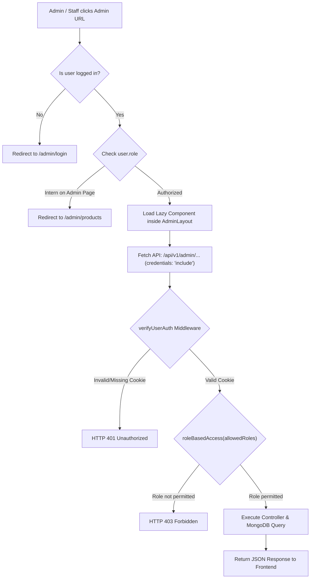

# 📘 Megha Himalayan — Administrator & Staff Operations Manual

> **System Version:** 2.0 (Eyewear, Lifestyle & Optical Platform)  
> **Currency:** Nepalese Rupee (NPR / Rs.)  
> **Target Audience:** Store Administrators, Inventory Managers, Fulfillment & Optical Interns, Technical Operators

---

## 📑 Table of Contents
1. [System Architecture & Role-Based Access Control](#1-system-architecture--role-based-access-control)
2. [How Admin Routes Work (Frontend & Backend Routing Architecture)](#2-how-admin-routes-work-frontend--backend-routing-architecture)
   - [2.1 Frontend Route Protection (`AdminRoute.jsx`)](#21-frontend-route-protection-adminroutejsx)
   - [2.2 Role-Based Sidebar Navigation (`AdminLayout.jsx`)](#22-role-based-sidebar-navigation-adminlayoutjsx)
   - [2.3 Code-Splitting, Lazy Loading & Error Boundaries](#23-code-splitting-lazy-loading--error-boundaries)
   - [2.4 Frontend Route Inventory](#24-frontend-route-inventory)
   - [2.5 Backend Authentication Pipeline (`verifyUserAuth` & `roleBasedAccess`)](#25-backend-authentication-pipeline-verifyuserauth--rolebasedaccess)
   - [2.6 Backend Admin API Route Inventory](#26-backend-admin-api-route-inventory)
   - [2.7 End-to-End Admin Request Flowchart](#27-end-to-end-admin-request-flowchart)
3. [Admin Dashboard & Real-Time Monitoring](#3-admin-dashboard--real-time-monitoring)
4. [Product Catalog & Variant Management](#4-product-catalog--variant-management)
5. [Optical Prescription & Order Fulfillment Workflow](#5-optical-prescription--order-fulfillment-workflow)
6. [Returns, Physical Inspections & Refund Disbursals](#6-returns-physical-inspections--refund-disbursals)
7. [Promotional Coupons & Marketing Campaigns](#7-promotional-coupons--marketing-campaigns)
8. [Customer Rewards & Points Ledger](#8-customer-rewards--points-ledger)
9. [Media Library & Asset Management (Cloudinary)](#9-media-library--asset-management-cloudinary)
10. [Customer CRM & Staff Role Assignment](#10-customer-crm--staff-role-assignment)
11. [Inquiry Messages & Live Socket Notifications](#11-inquiry-messages--live-socket-notifications)
12. [Sales Analytics & Business Intelligence](#12-sales-analytics--business-intelligence)
13. [Standard Operating Procedures (SOPs) & Checklists](#13-standard-operating-procedures-sops--checklists)
14. [Troubleshooting & Frequently Asked Questions](#14-troubleshooting--frequently-asked-questions)

---

## 1. System Architecture & Role-Based Access Control

The platform enforces strict role-based separation of concerns to safeguard financial metrics and customer data while granting operational staff catalog access.

### Role Hierarchy & Permissions Matrix

| Module / Feature | Super Admin (`admin`) | Operations Intern (`intern`) | Standard Customer (`user`) |
| :--- | :---: | :---: | :---: |
| **Sales Analytics & Revenue Metrics** | ✅ Full Access | ❌ Restricted | ❌ No Access |
| **Orders & Invoicing** | ✅ Full Access | ❌ Restricted | 🔍 Own Orders Only |
| **Returns & Refund Disbursals** | ✅ Full Access | ❌ Restricted | 🔍 Own Returns Only |
| **Product Catalog & Stock** | ✅ Full Access | ✅ Full Access | 👁️ View & Buy |
| **Media Library (Cloudinary)** | ✅ Full Access | ✅ Full Access | ❌ No Access |
| **Coupons & Discount Codes** | ✅ Full Access | ❌ Restricted | 🏷️ Redeem at Checkout |
| **User Directory & Role Assignment** | ✅ Full Access | ❌ Restricted | ❌ No Access |
| **Customer Contact Messages** | ✅ Full Access | ❌ Restricted | ✉️ Submit Inquiries |
| **Points Ledger Audits** | ✅ Full Access | ❌ Restricted | 🎁 Earn & Redeem |

---

## 2. How Admin Routes Work (Frontend & Backend Routing Architecture)

Understanding how routes function is essential for security, debugging, and daily navigation. The system protects admin routes using a **defense-in-depth model**: client-side route guards prevent unauthorized UI rendering, while server-side middleware prevents unauthorized data access.

### 2.1 Frontend Route Protection (`AdminRoute.jsx`)
All admin URL paths in [`client/src/App.jsx`](file:///c:/meghahimalayan/client/src/App.jsx) are wrapped by the [`<AdminRoute>`](file:///c:/meghahimalayan/client/src/components/admin/AdminRoute.jsx) higher-order component.

```jsx
function AdminRoute({ children, roles = ['admin'] }) {
  const { user, loading } = useAuth()

  if (loading) return null

  // 1. Unauthenticated users are redirected to the admin login portal
  if (!user) return <Navigate to="/admin/login" replace />

  // 2. Role-check: Verify if user's role is in the allowed roles array
  if (!roles.includes(user.role)) {
    // If an Intern attempts to open an admin-only page (e.g., /admin/orders or /admin/analytics),
    // they are automatically rerouted to their authorized area: /admin/products
    return user.role === 'intern'
      ? <Navigate to="/admin/products" replace />
      : <Navigate to="/admin/login" replace />
  }

  return children
}
```

#### Routing Rules:
1. **Unauthenticated Visitor:** If a user navigates directly to `/admin/dashboard` without a valid session, they are redirected to `/admin/login`.
2. **Standard Customer (`user`):** If a logged-in shopper navigates to any `/admin/*` route, they are rejected and redirected to `/admin/login`.
3. **Intern (`intern`):** Interns are permitted on routes with `roles={['admin', 'intern']}` (`/admin/products`, `/admin/products/new`, `/admin/products/:id/edit`, and `/admin/media`). If an intern manually types `/admin/analytics` or `/admin/orders` in the browser address bar, they are automatically rerouted to `/admin/products`.
4. **Super Admin (`admin`):** Granted access to all admin routes.

---

### 2.2 Role-Based Sidebar Navigation (`AdminLayout.jsx`)
In [`client/src/components/admin/AdminLayout.jsx`](file:///c:/meghahimalayan/client/src/components/admin/AdminLayout.jsx), the sidebar dynamically adapts its navigation links based on `user.role`:

```javascript
const INTERN_PATHS = ['/admin/products', '/admin/media']

const visibleNav = user?.role === 'intern'
  ? NAV_ITEMS.filter((item) => INTERN_PATHS.some((p) => item.path.startsWith(p)))
  : NAV_ITEMS
```
- **For Admins:** Displays all 10 navigation tabs: *Dashboard, Analytics, Orders, Returns, Products, Media Library, Users, Coupons, Messages, and Notifications*.
- **For Interns:** The navigation bar displays **only** *Products* and *Media Library*. All financial, order, and customer menus are hidden from the layout.
- **Responsive Layout:** On desktop (screen width $\ge 768\text{px}$), the sidebar can be toggled between expanded ($240\text{px}$) and collapsed icon mode ($64\text{px}$). On mobile devices ($< 768\text{px}$), it renders as an off-canvas drawer with a dark backdrop overlay.

---

### 2.3 Code-Splitting, Lazy Loading & Error Boundaries
To keep page load speeds fast for regular shoppers on mobile networks, all admin pages are decoupled from the main bundle:
- **`React.lazy()` Code-Splitting:** Components like `Dashboard`, `Analytics`, `AdminOrders`, and `AdminProductForm` are only downloaded when an admin user navigates to an admin route.
- **`<Suspense fallback={<AdminPageLoader />}>`:** Renders an admin loader spinner during bundle transitions.
- **`<ErrorBoundary>`:** Every admin route is wrapped in an isolated error boundary. If a network failure occurs on one admin screen, it displays a retry banner without crashing the entire administration layout.

---

### 2.4 Frontend Route Inventory

| URL Path | Permitted Roles | Component | Description |
| :--- | :---: | :--- | :--- |
| `/admin/login` | Public / Guest | `AdminLoginPage` | Dedicated login form for store management |
| `/admin/dashboard` | `admin` | `Dashboard` | Real-time KPI counters & live orders |
| `/admin/analytics` | `admin` | `Analytics` | Sales graphs, AOV, and top customers |
| `/admin/orders` | `admin` | `AdminOrders` | Order management and status filtering |
| `/admin/orders/:id` | `admin` | `AdminOrderDetail` | Prescription review, status update, deletion |
| `/admin/products` | `admin`, `intern` | `AdminProducts` | Catalog inventory table & stock search |
| `/admin/products/new` | `admin`, `intern` | `AdminProductForm` | New product creation with variants |
| `/admin/products/:id/edit` | `admin`, `intern` | `AdminProductForm` | Product edit, pricing, and variant updates |
| `/admin/media` | `admin`, `intern` | `AdminMediaLibrary` | Cloudinary asset & folder manager |
| `/admin/users` | `admin` | `AdminUsers` | Customer list & registration dates |
| `/admin/users/:id` | `admin` | `AdminUserDetail` | Customer profile & role modification |
| `/admin/coupons` | `admin` | `AdminCoupons` | Promotional code discount manager |
| `/admin/messages` | `admin` | `AdminMessages` | Customer contact form inquiries |
| `/admin/returns` | `admin` | `AdminReturns` | Return requests management |
| `/admin/returns/:id` | `admin` | `AdminReturnDetail` | Inspection report & refund disbursal |
| `/admin/notifications` | `admin` | `AdminNotifications`| Notification center with mark-all-read |

---

### 2.5 Backend Authentication Pipeline (`verifyUserAuth` & `roleBasedAccess`)
On the Express server, every administrative API route is protected by a two-stage security pipeline in [`server/middleware/userAuth.js`](file:///c:/meghahimalayan/server/middleware/userAuth.js):

```javascript
router.get("/admin/orders", verifyUserAuth, roleBasedAccess("admin"), getAllOrders);
router.post("/admin/product/create", verifyUserAuth, roleBasedAccess("admin", "intern"), createProduct);
```

#### Pipeline Stages:
1. **Stage 1: `verifyUserAuth`**
   - Extracts the JWT from the secure `httpOnly` cookie (`token`).
   - Verifies cryptographic signature using `process.env.JWT_SECRET_KEY`.
   - Fetches the user record from MongoDB (`User.findById(decoded.id)`).
   - Validates that `user.isDeleted === false` and `user.isActive === true`.
   - Checks if the user changed their password after the token was issued (`user.isPasswordChangedAfter(decoded.iat)`). If true, the token is invalidated immediately.
   - Attaches the authenticated user to `req.user`.
2. **Stage 2: `roleBasedAccess(...roles)`**
   - Inspects `req.user.role`.
   - If `roles.includes(req.user.role)` is false, halts execution immediately and returns `HTTP 403 Forbidden`:  
     `{ success: false, message: "Role 'intern' is not permitted to access this resource" }`.
3. **Cookie Configuration (`credentials: 'include'`):**
   - In [`client/src/api/adminClient.js`](file:///c:/meghahimalayan/client/src/api/adminClient.js), every fetch request specifies `{ credentials: 'include' }` to ensure the session cookie is transmitted securely with API calls.

---

### 2.6 Backend Admin API Route Inventory

| API Endpoint | Method | Middleware Guard | Action / Controller |
| :--- | :---: | :--- | :--- |
| `/api/v1/admin/dashboard` | `GET` | `verifyUserAuth`, `admin` | Returns aggregated metrics & recent orders |
| `/api/v1/admin/analytics` | `GET` | `verifyUserAuth`, `admin` | Returns revenue charts, sales by category |
| `/api/v1/admin/customers/top` | `GET` | `verifyUserAuth`, `admin` | Returns top VIP customers by spend |
| `/api/v1/admin/orders` | `GET` | `verifyUserAuth`, `admin` | Paginated orders with status filtering |
| `/api/v1/admin/order/:id` | `GET` | `verifyUserAuth`, `admin` | Order details with prescription snapshot |
| `/api/v1/admin/order/:id` | `PUT` | `verifyUserAuth`, `admin` | Update status (`Confirmed`, `Shipped`, etc.) |
| `/api/v1/admin/order/:id` | `DELETE`| `verifyUserAuth`, `admin` | Permanently deletes an order record |
| `/api/v1/admin/order/:id/invoice`| `GET` | `verifyUserAuth`, `admin` | Generates and streams PDF tax invoice |
| `/api/v1/admin/products` | `GET` | `verifyUserAuth`, `admin`, `intern` | Catalog list with stock and filter query |
| `/api/v1/admin/product/create` | `POST` | `verifyUserAuth`, `admin`, `intern` | Creates new product with variants |
| `/api/v1/admin/product/:id` | `PUT` | `verifyUserAuth`, `admin`, `intern` | Updates product specifications and stock |
| `/api/v1/admin/product/:id` | `DELETE`| `verifyUserAuth`, `admin`, `intern` | Deletes product listing |
| `/api/v1/admin/media/folders` | `GET` / `POST` / `DELETE` | `verifyUserAuth`, `admin`, `intern` | Manages Cloudinary directory tree |
| `/api/v1/admin/media/assets` | `GET` / `POST` / `DELETE` | `verifyUserAuth`, `admin`, `intern` | Uploads, deletes, or moves images |
| `/api/v1/admin/users` | `GET` | `verifyUserAuth`, `admin` | List registered customers |
| `/api/v1/admin/user/:id` | `GET` / `PUT` / `DELETE` | `verifyUserAuth`, `admin` | Update user roles or delete accounts |
| `/api/v1/admin/coupons` | `GET` / `POST` | `verifyUserAuth`, `admin` | List and create discount promo codes |
| `/api/v1/admin/coupon/:id` | `PUT` / `DELETE` | `verifyUserAuth`, `admin` | Edit discount caps or delete coupon |
| `/api/v1/admin/messages` | `GET` | `verifyUserAuth`, `admin` | View contact form submissions |
| `/api/v1/admin/message/:id` | `PUT` / `DELETE` | `verifyUserAuth`, `admin` | Update inquiry status or delete message |
| `/api/v1/admin/returns` | `GET` | `verifyUserAuth`, `admin` | List customer return and exchange tickets |
| `/api/v1/admin/return/:id` | `GET` / `PUT` | `verifyUserAuth`, `admin` | Inspect return condition & disburse refund |
| `/api/v1/admin/notifications` | `GET` / `PUT` | `verifyUserAuth`, `admin` | Retrieve and acknowledge notifications |

---

### 2.7 End-to-End Admin Request Flowchart



---

## 3. Admin Dashboard & Real-Time Monitoring

**Route:** `/admin/dashboard`

The dashboard functions as the real-time operational cockpit for daily store performance. It connects via **Socket.IO** to receive live order and notification events without page refreshes.

### Key Metrics & Indicators:
- **Total Revenue (Rs.):** Aggregated earnings from confirmed and delivered transactions.
- **Total Orders:** Live volume of orders placed across all statuses.
- **Total Products:** Total active SKUs in the catalog.
- **Registered Customers:** Total registered customer accounts.
- **Live Indicator Pulse:** A green pulsing badge in the top right confirms active real-time socket connectivity.
- **Recent Orders Table:** Quick-glance view of the last 10 orders with instant status badges (`Processing`, `Confirmed`, `Shipped`, `Delivered`, `Cancelled`).

---

## 4. Product Catalog & Variant Management

**Routes:** List: `/admin/products` | New: `/admin/products/new` | Edit: `/admin/products/:id/edit`

Megha Himalayan manages four specialized product verticals: **Eyeglasses, Contact Lenses, Watches, and Perfumes**.

### A. General Information
- **Product Name:** Standard full title (e.g., *Ray-Ban Aviator Classic Polarized*).
- **Description:** Formatted product summary highlighting styling, dimensions, and specifications.
- **Category:** `eyeglasses`, `contact-lenses`, `watches`, or `perfumes`.
- **Brand:** Manufacturer or brand label (e.g., *Ray-Ban, Oakley, Casio, Dior*).
- **Subcategory:** Contextual classification (e.g., `Prescriptive` vs. `Non-Prescriptive` for contact lenses, `Aviator` for sunglasses).
- **Gender:** Select from `Men`, `Women`, `Kids`, or `Unisex`.
- **Pricing & Discounts:**
  - **Regular Price (`price`):** Standard price in NPR.
  - **Discount Price (`discountPrice`):** Offer price.
  - *Validation Rule:* `discountPrice` must be strictly lower than `price`. If invalid, the form will reject submission.
- **Stock:** Total base unit inventory.
- **Marketing Toggles:**
  - `isFeatured`: Showcases product on homepage hero sections.
  - `isBestSeller`: Adds Best Seller badge across product grids.
  - `isNewArrival`: Features item in seasonal arrival sliders and email newsletters.
- **Points Cost:** (Optional) Point value required if item is redeemable exclusively through reward points.

### B. Vertical-Specific Technical Attributes

#### 👓 Eyeglasses
- **Frame Shape:** Oval, Round, Square, Rectangle, Cat Eye, Aviator, Geometric, Browline.
- **Frame Material:** Acetate, Titanium, Metal, TR-90, Wood, Ultem.
- **Frame Color:** Black, Tortoise, Gold, Silver, Gunmetal, Clear, Rose Gold.
- **Lens Type:** Single Vision, Progressive, Blue-Cut Digital, Zero Power, Polarized Sunglass.

#### 👁️ Contact Lenses
- **Base Curve (BC):** Standard curvature in millimeters (e.g., `8.6mm`).
- **Diameter (DIA):** Lens diameter in millimeters (e.g., `14.2mm`).
- **Water Content (%):** Moisture percentage (e.g., `38%`, `55%`, `69%`).
- **Replacement Schedule:** `Daily Disposable`, `Bi-Weekly`, `Monthly`, `Quarterly`, `Yearly`.
- **Pack Size:** Number of lenses per pack (e.g., `2 Lenses`, `6 Lenses`, `30 Lenses`).
- **Prescription Required:** Toggle indicating whether an optical power selection is mandatory before cart insertion.

#### ⌚ Watches
- **Watch Type:** Analog, Digital, Chronograph, Automatic, Smartwatch.
- **Dial Color:** Color of the watch face.
- **Strap Material:** Genuine Leather, Stainless Steel Mesh, Silicone, Ceramic, Titanium.
- **Case Size:** Diameter in millimeters (e.g., `40mm`, `44mm`).
- **Movement Type:** Japanese Quartz, Swiss Automatic, Solar.
- **Water Resistance:** `3 ATM (30m)`, `5 ATM (50m)`, `10 ATM (100m)`, `20 ATM (200m)`.

#### 🌸 Perfumes
- **Fragrance Family:** Woody, Floral, Fresh, Oriental, Citrus, Aromatic.
- **Fragrance Type:** Eau de Parfum (EDP), Eau de Toilette (EDT), Parfum, Cologne.
- **Volume:** Milliliters (e.g., `50ml`, `100ml`, `150ml`).

### C. Multi-Color Variants & Variant Image Galleries
For products with multiple colorways:
1. Click **Add Variant**.
2. Enter **Color Name** (e.g., `Havana Tortoise`).
3. Set **Hex Color Code** (e.g., `#6F4E37`) for visual color swatches.
4. Set **Variant Stock** and unique **SKU**.
5. Set **Variant Price / Discount Price** if that specific colorway has a pricing tier differential.
6. Upload variant-specific images. When customers toggle colors on the frontend, the image carousel automatically switches to that color's photo set.

---

## 5. Optical Prescription & Order Fulfillment Workflow

**Routes:** List: `/admin/orders` | Details: `/admin/orders/:id`

Eyewear fulfillment demands meticulous verification to prevent optical dispensing errors.

### The Order Status Lifecycle

```
[Processing] ──► [Confirmed] ──► [Shipped] ──► [Delivered]
      │
      └──► [Cancelled] (If customer requested, out of stock, or invalid prescription)
```

### Optical Prescription Inspection Checklist
When opening an order containing eyeglasses or prescriptive contact lenses, review the **Prescription Snapshot**:
1. **Right Eye ($OD$):**
   - **Sphere ($SPH$):** Distance/near correction (+8.00 to -12.00).
   - **Cylinder ($CYL$):** Astigmatism correction.
   - **Axis:** Astigmatism angle (0° to 180°). Must be present if Cylinder is specified.
   - **Add Power ($ADD$):** Reading addition for bifocals / progressive lenses.
2. **Left Eye ($OS$):** SPH, CYL, Axis, ADD.
3. **Pupillary Distance ($PD$):**
   - Single PD (e.g., `62mm`) or Dual PD (`PD Right` / `PD Left`, e.g., `31mm / 31mm`).
4. **Prescription Attachment:** Click the uploaded photo/scan of the doctor’s slip to verify clinic doctor signature, patient name, and prescription date.
5. **Special Instructions / Notes:** Read any customer comments regarding frame fitting, tinted lenses, or PD measurements.

### Payment Verification
- **Cash on Delivery (COD):** Check phone validity before dispatch. Call customer if address details are incomplete.
- **eSewa & Khalti:** Automated digital confirmation.
- **Direct Bank Transfer:** Review the uploaded payment receipt screenshot. Reconcile deposit amount against company bank balance before setting status to `Confirmed`.

### Invoice Generation
Click **Download Invoice** to generate a PDF tax invoice containing order number, customer shipping address, optical prescription snapshot, item breakdowns, discounts, and tax totals.

---

## 6. Returns, Physical Inspections & Refund Disbursals

**Routes:** List: `/admin/returns` | Details: `/admin/returns/:id`

Megha Himalayan provides a structured workflow for handling return requests, warranty claims, and refunds.

### The Return Lifecycle

```
[Pending] ──► [Approved] ──► [Item Received] ──► [Completed] (Refund Disbursed)
    │                                 │
    └──► [Rejected]                   └──► [Rejected] (Failed physical inspection)
```

### Admin Return Processing Steps:
1. **Initial Review (`Pending`):**
   - Review customer return reason: `Wrong Item Received`, `Damaged Item`, `Not As Described`, `Changed Mind`, `Missing Parts/Accessories`, or `Other`.
   - Review uploaded customer photos of the item defect or packaging.
   - If valid, change status to **`Approved`** and add **Admin Remarks** with instructions on sending the item to the warehouse.
2. **Physical Inspection Upon Arrival (`Item Received`):**
   - Once the courier delivers the package to the warehouse, inspect each returned product.
   - Record **Item Condition**:
     - `Unopened`: Original factory seal intact.
     - `Opened/Good`: Opened but pristine condition, no scratches.
     - `Damaged/Defective`: Scratched lenses, broken hinges, cosmetic wear.
     - `Missing Parts`: Protective case, microfiber cloth, or accessories absent.
   - Toggle **Restockable**: Enable if item can be safely returned to live store stock.
3. **Refund Authorization & Disbursal (`Completed`):**
   - Select **Refund Method**:
     - `eSewa/Khalti`: Reverse payment or manual wallet transfer.
     - `Bank Transfer`: Direct bank transfer to the customer's provided account.
     - `Store Credit`: Account credit for alternative product selection.
     - `Original Payment Method`: Automated digital payment reversal.
   - Enter **Approved Refund Amount** (deducting delivery charges if return reason is "Changed Mind").
   - Record the transaction bank reference number in remarks.
   - Click **Process Refund**. The customer is notified via email and in-app alert.

---

## 7. Promotional Coupons & Marketing Campaigns

**Route:** `/admin/coupons`

Create, monitor, and expire discount codes.

### Configuration Fields:
- **Code:** Case-insensitive alphanumeric code (e.g., `DASHAIN15`, `FESTIVE500`).
- **Discount Type:**
  - `percentage`: Deducts a percentage from the cart subtotal.
  - `fixed`: Deducts an exact rupee amount.
- **Discount Value:** Numeric percentage or rupee value.
- **Minimum Order Value (`minOrder`):** Cart total required to apply coupon (e.g., Rs. 3,000).
- **Maximum Discount Cap (`maxDiscount`):** Caps percentage discounts (e.g., 20% off up to a maximum cap of Rs. 1,000).
- **Usage Limits:**
  - `usageLimit`: Total allowable redemptions across all store customers.
  - `perUserLimit`: Maximum times a single customer account can apply the code (typically `1`).
- **Expires At:** Date and time after which the coupon automatically disables.
- **Public Promotion Toggle (`isPublic`):**
  - If enabled, the coupon appears in banner marquees and checkout suggestions.
  - If disabled, the coupon remains private for exclusive marketing or customer apology tokens.

---

## 8. Customer Rewards & Points Ledger

The platform runs a loyalty program integrated into the MongoDB `PointsLedger`.

### Rules & Parameters:
- **Earning Rate:** **1 Point earned for every Rs. 100 spent** on completed purchases.
- **Credit Timing:** Points are credited automatically when order status reaches `Delivered` (for COD) or upon successful digital payment.
- **Redemption Rate:** **10 Points = Rs. 1 discount** at checkout.
- **Safety Cap:** Points discount can cover at most **20%** of an order's net subtotal.
- **Expiration Window:** Unused points expire after **30 days**.
- **Idempotency Protection:** The system prevents duplicate points awards through compound unique indexes on `{ order: 1, type: "earn" }`.

---

## 9. Media Library & Asset Management (Cloudinary)

**Route:** `/admin/media`

A centralized visual asset manager for catalog imagery, campaign lookbooks, and site banners.

### Features:
- **Folder Navigation:** Organize assets into structured directories (e.g., `/collections/spring-eyewear/acetate`).
- **Folder Creation & Deletion:** Add new directories or delete empty folders.
- **Direct Upload:** Upload multiple PNG, JPEG, or WebP files with automatic compression and CDN delivery.
- **Asset Moving:** Move assets between folders without altering permanent Cloudinary public URLs.
- **Asset Deletion:** Permanently purge outdated banner or discontinued product photos.

---

## 10. Customer CRM & Staff Role Assignment

**Routes:** List: `/admin/users` | Detail: `/admin/users/:id`

- **Customer Dossier:** View customer email, full name, phone number, saved delivery addresses, registration date, accumulated points, and lifetime orders.
- **Role Assignment:** Update access roles between `user`, `intern`, and `admin`.
  - To assign an intern: Select `intern` from the role dropdown.
  - Changes take effect on the staff member's next session or navigation click.

---

## 11. Inquiry Messages & Live Socket Notifications

### Contact Messages (`/admin/messages`)
Manages inquiries submitted through the store's public `/contact` form.
- Filter messages by status: `New` (Unread), `Read`, `Replied`, `Closed`.
- Expand messages to view sender email, phone number, subject, and text inquiry.
- Update message statuses to keep customer support tickets organized.

### Real-Time Notifications (`/admin/notifications`)
- Bell icon in the admin header displays unread alert badges.
- Alerts trigger automatically when:
  - A customer places a new order.
  - A customer submits a return request.
  - A product falls below minimum stock thresholds.
  - A contact message is submitted.
- One-click mark as read or mark all as read.

---

## 12. Sales Analytics & Business Intelligence

**Route:** `/admin/analytics`

Comprehensive business intelligence reporting:
- **Revenue Trends:** Visual charts of daily, weekly, and monthly sales volume.
- **Average Order Value (AOV):** Tracks basket size dynamics over time.
- **Top Selling Products:** Identifies best-performing frames, lenses, and lifestyle SKUs.
- **Top Customers:** Identifies high-lifetime-value VIP customers for targeted marketing.

---

## 13. Standard Operating Procedures (SOPs) & Checklists

### SOP 1: Daily Morning Order Fulfillment Checklist
- [ ] Open `/admin/dashboard` and review unread notifications.
- [ ] Filter `/admin/orders` by status `Processing`.
- [ ] For each eyewear order:
  - [ ] Verify lens selection (Single Vision, Blue Cut, Progressive).
  - [ ] Check optical parameters ($SPH$, $CYL$, $Axis$, $PD$).
  - [ ] Compare manual inputs against the doctor's prescription slip photo.
  - [ ] If prescription is unclear or $PD$ is missing, hold order and message customer.
- [ ] For Bank Transfer orders, verify payment receipt in company bank account.
- [ ] Change status to `Confirmed`. Print packing slip and PDF invoice.
- [ ] Hand over packaged parcel to courier dispatch and update status to `Shipped`.

### SOP 2: Returns & Warranty Inspection Checklist
- [ ] Review new requests in `/admin/returns`.
- [ ] Verify whether order was delivered within the valid return window.
- [ ] Once received at warehouse, inspect frame alignment, lens surface scratches, and accessories.
- [ ] Fill out condition report (`Unopened`, `Opened/Good`, `Damaged/Defective`).
- [ ] If restockable, toggle inventory restock.
- [ ] Disburse refund via eSewa, Khalti, or Bank Transfer and record reference code.
- [ ] Change status to `Completed`.

---

## 14. Troubleshooting & Frequently Asked Questions

**Q: A customer entered Sphere power but forgot Pupillary Distance ($PD$). Can we process the lenses?**  
*A:* No. Lenses edged without an accurate $PD$ will cause optical prism distortion, eye strain, and headaches. Place the order on hold, call or email the customer, and request their optical clinic $PD$ measurement.

**Q: An intern cannot see the orders or revenue analytics. Is there a glitch?**  
*A:* No. This is intended by design. The `intern` role is restricted exclusively to Products and the Media Library to protect business finances and customer privacy.

**Q: Why was a discount price not saved when updating a product?**  
*A:* The system requires that `discountPrice` must be strictly lower than regular `price`. Ensure the discount price is not greater than or equal to the regular price.

**Q: When are loyalty points credited for Cash on Delivery (COD) orders?**  
*A:* Points are credited only when the order status is updated to `Delivered`. If an order is marked `Cancelled`, points are never issued.
